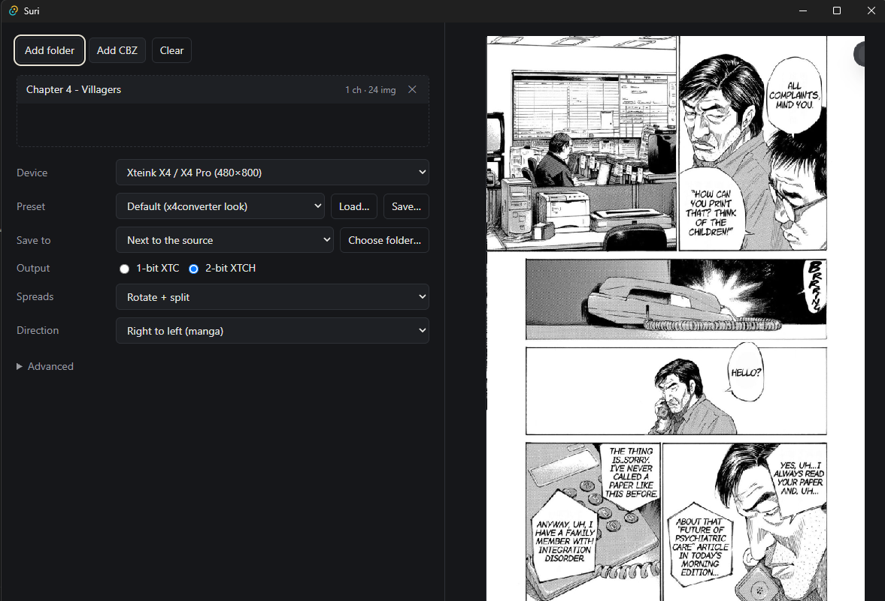

<div align="center">

# Suri (摺り)

**Press your manga and comics into e-reader-ready XTC files.**

[](https://github.com/A1ZES/Suri/releases/latest)


[](LICENSE)



<sub>Sample page: <i>Say Hello to Black Jack</i> by Shuho Sato, free for secondary use.</sub>

</div>

*Suri* is the step in Japanese woodblock printing where paper is pressed onto the inked block. Suri does the same for your manga. It takes a folder of pages and turns it into a file that looks sharp on a small e-ink screen.

> [!NOTE]
> **Suri is in alpha.** It's very new and changing fast. Today it outputs XTC/XTCH for Xteink readers only; more formats and devices are on the way.

## Download

**[Get the latest version →](https://github.com/A1ZES/Suri/releases/latest)**

| System | File to download |
|---|---|
| Windows | `Suri_x.y.z_x64-setup.exe` |
| macOS | `Suri_x.y.z_universal.dmg` |
| Linux | `.AppImage`, `.deb` or `.rpm` |

Install it once and Suri **updates itself**: when a new version is out, it asks you on startup.

> [!TIP]
> Windows may say *"Windows protected your PC"* because the app isn't signed yet. Click **More info → Run anyway**.

## About this project

I started Suri for two reasons: I wanted to learn Rust, and I wanted to build something useful for the e-ink community.

The idea is simple: one free, open-source app where you can do everything, instead of jumping between a thousand different tools. Everyone can download it, use it, and change it.

Right now Suri focuses on XTC, the format used by Xteink readers. That's only the start. More output formats and devices will come as the project grows.

## Features

- 👁️ **Live preview:** see each page exactly as the e-reader will show it.
- ⚡ **Fast and offline:** a 2,300-page series converts in about 40 seconds, with no upload.
- 📚 **Whole series:** a folder of chapters becomes one book with a chapter list.
- 🖤 **Made for e-ink:** auto-crop, contrast, gamma and five dithering methods.
- 📖 **Spreads:** split, rotate or both, in manga or comic reading order.
- 🎛️ **Fully customizable:** change any option and save it as a preset.

## Supported devices

| Device | Resolution | Output |
|---|---|---|
| Xteink X4 / X4 Pro | 480 × 800 | XTC, XTCH |
| Xteink X3 | 528 × 792 | XTC, XTCH |
| reTerminal Sticky | 480 × 800 | XTC, XTCH |

Kindle, Kobo and reMarkable screen sizes are already in [`devices.toml`](crates/core/devices.toml) for future CBZ/EPUB output.

**Input:** folders of JPG, PNG or WebP images, and CBZ/ZIP archives. A folder of chapter folders (or of CBZ files) becomes one book with chapters.

## Run from source

For developers who'd rather clone the repo. You need [Rust](https://rustup.rs) and [Node.js](https://nodejs.org) 20+. On Windows, the Rust installer also sets up the Visual Studio C++ build tools.

```sh
git clone https://github.com/A1ZES/Suri.git
cd Suri/app
npm install
npm run tauri dev      # run the app
```

<details>
<summary><b>Command line</b></summary>

Everything the app does is also available as a command-line tool, for batch jobs and scripts:

```sh
cargo run --release -p suri-cli -- convert "Mangas/Centuria"              # → Mangas/Centuria.xtch
cargo run --release -p suri-cli -- convert "Vol 1.cbz" --device x3 --depth 1
cargo run --release -p suri-cli -- convert "Mangas/Centuria" --preset my-preset.toml
cargo run --release -p suri-cli -- info Centuria.xtch                     # pages, chapters
cargo run --release -p suri-cli -- dump Centuria.xtch --page 3            # page → PNG
```

</details>

<details>
<summary><b>How it works</b></summary>

```
folder / CBZ ─▶ decode ─▶ crop margins ─▶ tone (gamma, contrast)
            ─▶ layout (cover, spreads, resize to the screen)
            ─▶ quantize + dither (1-bit or 2-bit) ─▶ XTC / XTCH file
```

| Path | What it is |
|---|---|
| [`crates/core`](crates/core) | The engine: the XTC/XTCH format, the image pipeline and the device list |
| [`crates/cli`](crates/cli) | The `suri` command-line tool |
| [`app`](app) | The desktop app (Tauri + TypeScript), a thin layer over the engine |

Run the tests with `cargo test --workspace`.

</details>

## License

[MIT](LICENSE). Free to use, modify and share.

Suri is an independent project, not affiliated with Xteink.
